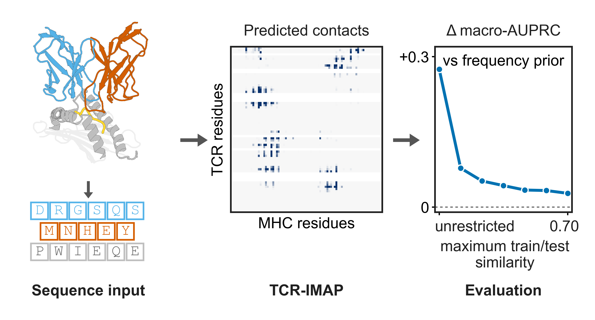
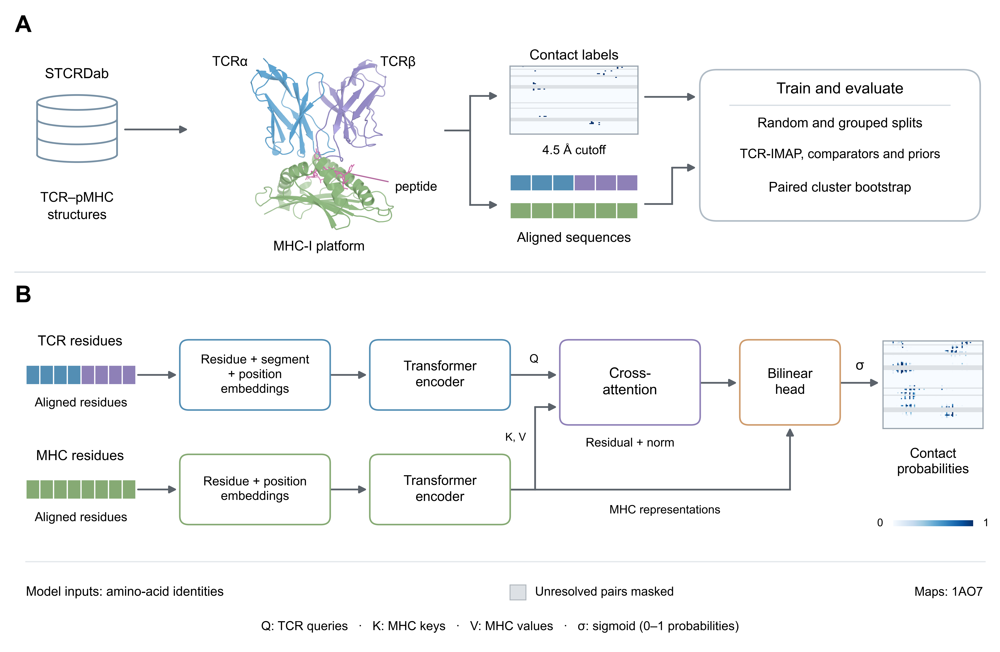

# TCR-IMAP: A Dual-Encoder Cross-Attention Model for TCR–MHC Platform Contact Map Prediction

[](LICENSE)
[](https://www.python.org/)
[](https://pytorch.org/)

**Official implementation of TCR-IMAP**, a dual-encoder cross-attention model that predicts the
complete TCR-residue × MHC-residue contact map of the class I α1/α2 platform from amino-acid
sequence alone, together with the frozen benchmark and homology-controlled evaluation it was
measured under.

> **TCR-IMAP: A Dual-Encoder Cross-Attention Model for TCR–MHC Platform Contact Map Prediction**
> Muhammad Imran, Waqar Ali, Syed Mansoor Jan, Muhammad Rizwan, Adil Farooq, Wanwan Huang\*, Dongqing Wei\*
> Submitted to *Journal of Chemical Information and Modeling*, manuscript ID **ci-2026-04054n**.
> \*Corresponding authors.



---

## Highlights

* **The contribution is the evaluation framework, not architectural novelty.** The claim is not that
  TCR-IMAP is a better architecture; it is that how much of a sequence-based TCR–MHC contact
  predictor's apparent accuracy belongs to the evaluation rather than to the model can be measured,
  and that this package contains the frozen apparatus for measuring it.
* **The predeclared primary comparison is unresolved at this sample size.** Per-residue macro-AUPRC
  under `tcr70`, TCR-IMAP versus Struct-TCS: **+0.0312 (95 % CI [−0.0049, +0.0650], p = 0.088)**. It
  is reported as it stands, and no more favourable secondary comparison was promoted in its place.
* **On the pairwise task the margins are clear.** TCR-IMAP **0.3598** against the within-fold
  pair-frequency prior 0.3090 (**+0.0507 [+0.0215, +0.0841], p < 0.001**, higher on 112/174) and
  against TEIM-Res 0.2725 (**+0.0873 [+0.0592, +0.1149], p < 0.001**, higher on 143/174).
* **Apparent accuracy falls as homology control tightens.** Without any similarity restriction the
  pairwise advantage over the prior is **+0.2750**; at a 0.70 train/test ceiling it is **+0.0274**.
  A size-matched control shows that smaller training sets alone do not explain the decline.
* **A characterized benchmark, not an assumed one.** 174 TCR–peptide–MHC class I structures, all
  with a human MHC class I heavy chain, collapsing to **69 TCR clusters** at a similarity ratio of
  0.70; **57.5 %** of complexes have an exact TCR twin. Five partitioning protocols were frozen
  before any result was produced.
* **Everything the numbers were computed from is released**: contact labels and candidate masks keyed
  by IMGT number *and* insertion code, within-fold priors, stored per-complex and per-pair
  predictions, paired metrics and a clustered bootstrap.

### What this does not establish

1. **There is no sequence-to-input builder.** `src/data/p84v2.py` exposes `T_for(pdbs)` and
   `M_for(pdbs)`, which look complexes up **by PDB identifier** in the frozen representation.
   Applying the model to a receptor outside this cohort needs an IMGT numbering step that this
   package documents but does not implement: ANARCI or equivalent for the TCR V domains, and
   per-domain alignment for the MHC G domain — never a fixed offset, which mismatches 66 of 126 α2
   positions. **Insertion codes must be preserved**: keying residues by IMGT number alone silently
   overwrites 12 residues at position 111, drops 63 at 112, and puts 1061A and 1072A in the base
   columns. That defect existed in an earlier build of this project and is the most likely way to
   misuse the representation.
2. **Scope of the evidence.** Paired αβ TCRs on human MHC class I, α1/α2 platform. Receptors are
   human in 165 of 174 complexes, mouse in 8, and one has a mixed chimpanzee/human α chain. MHC
   class II, γδ receptors and non-human MHC are out of scope.
3. **One robustness check could not be completed from stored artifacts.** The canonical-CDR-only
   (FR4) sensitivity covers 14 comparisons, the largest change being 0.0014, but **not** the
   predeclared per-residue primary: the per-residue benchmark writes no checkpoint at all and stores
   metrics rather than predictions, so that one comparison cannot be rescored without retraining.
   `results/review/FR4_CHECKPOINT_AUDIT.md` records the evidence. The gap is in one robustness
   check, not in the primary comparison, which was computed over its full predeclared candidate
   universe. **No historical per-residue checkpoint or prediction array exists, and none is claimed
   to.**
4. **The `double` protocol is legacy.** It selects the intersection of held-out cluster and allele
   groups but trains on all non-test complexes, so its held-out groups remain in training. It is
   kept, clearly labelled "intersection (legacy)", and is **not** part of any strictness ordering.
5. **No published comparator number is reproduced**, and none of ours is comparable to one. The
   comparators are architecture comparisons under common inputs;
   `results/review/COMPARATOR_PROVENANCE.md` records every deviation from each published
   specification.
6. **Molecular-dynamics trajectories are not included.** See *Data → Molecular dynamics*.

---

## Model Architecture



1. **TCR encoder** — amino-acid identities of the six CDR loops, embedded per residue over the 75
   occupied IMGT rows (68 positions plus 7 CDR3 insertion rows).
2. **MHC encoder** — amino-acid identities of the 84-column α1/α2 window (IMGT 50–90 and 1050–1090,
   plus insertion positions 1061A and 1072A).
3. **Cross-attention** — the two encoders attend to each other, so every TCR row is contextualised
   by the MHC window and vice versa.
4. **Bilinear pair head** — scores all 75 × 84 candidate residue pairs of a complex in one pass
   (529,310 trainable parameters at this layout).
5. **Per-residue variant** — the same encoders with a per-row output, matching the output format of
   published residue-level predictors (291,073 parameters).

---

## Installation

### Requirements

Python 3.10, PyTorch 2.x. The pinned environment is in `env/`.

```bash
conda env create -f env/environment.yml && conda activate tcr-imap
# or
pip install -r env/requirements.txt
```

> External tools that are not pip-installable (GROMACS, CHARMM-GUI, DSSP, PyMOL) are listed in
> `env/EXTERNAL_TOOLS.md`. None of them is needed to reproduce the reported numbers from the stored
> arrays.

---

## Quick Start

### Verify the frozen artifacts

```bash
python tests/test_frozen_artifacts.py       # integrity of the frozen artifacts, seconds
```

### Score the released predictions

This package **scores the released prediction arrays**; it does not predict for a new receptor.
There is no sequence-to-input builder, so there is no inference entry point that takes a TCR and an
MHC allele and returns a contact map. `worked_example.py` checks the released arrays against the
frozen labels, masks, identifiers and cluster assignments, then recomputes the pairwise `tcr70`
comparisons and the identity sweep, printing each computed value beside the value in the paper.

```bash
python scripts/worked_example.py            # the headline pairwise numbers, under a minute, CPU
```

> CPU only, no network, no GPU. If it reports missing arrays you have the **GitHub tree** without the
> frozen data: see `DATA.md`. The data lives in the Zenodo archive, and the two correspond by source
> revision recorded in `PACKAGE_INFO.json`.

---

## Data

### Input format

| array | shape | what it is |
|---|---|---|
| `data/processed/pair_maps_p84v2.npz` | 174 × 75 × 84 | contact labels `Y` and candidate masks `S`, with row and column manifests |
| `results/tables/pairmaps_{protocol}_p84v2.npz` | 174 × 75 × 84 | stored pairwise predictions `pred_model`, `pred_freq` |
| `data/splits_v2/protocols.json` | 5 protocols | the frozen partitions, never regenerated |
| `data/processed/complex_metadata.tsv` | 174 rows | the cohort table with clu70/80/90 |

### Data sources

| source | use |
|---|---|
| STCRDab and the Protein Data Bank | the 174-complex cohort; structures are referenced, not redistributed |
| `data/interim/stcrdab_index.tsv` | the STCRDab index rows for the cohort |

> `DATA_DICTIONARY.md` documents every released array and table field by field. Most `.npz` files
> need `allow_pickle=True`. Read the MD tables with `float_precision="round_trip"`.

### Molecular dynamics

`md/MD_SYSTEM_SELECTION_CRITERIA.md` holds the predeclared criteria, the system selection, the
protocol and the analysis definitions. `md/protocol/*.mdp` are the GROMACS parameter files,
`md/systems/BUILD_MANIFEST.tsv` records how the four systems were built, `md/analysis/` holds the
analysis code and its tests, and `results/tables/md_*.csv` hold the twelve output tables the single
authorised run produced. An independent party can therefore repeat the occupancy analysis.

Within this project the occupancy analysis is run-once by design, gated by a local authorisation
file that is deliberately not included. **That gate is a project-internal safeguard against
re-running a predeclared analysis after seeing its result, not a restriction on anyone else, and
nothing here says the analysis must never be repeated.**

**Trajectories and CHARMM-GUI bundles are not in this package.** The twelve 200 ns replicates are
7.7 GB as stored here and far larger with full-resolution coordinates, and the four CHARMM-GUI
bundles are 3.3 GB. Everything needed to regenerate them is included: the structures are public, the
build manifest records the CHARMM-GUI parameters, and the `.mdp` files carry the protocol and seeds.
The MD trajectories are available from the corresponding author on reasonable request.

---

## Reproducing Paper Results

`REPRODUCE.md` lists every command that reproduces a table or figure from stored results, and gives
separate instructions and resource estimates for the optional retraining.

### Headline numbers, from stored arrays

```bash
python scripts/worked_example.py
python scripts/69_sweep_authoritative_stats.py
```

### Benchmark, sensitivities and controls

```bash
python scripts/55_stats_p84v2.py
python scripts/61_validation_split_paired.py
python scripts/65_same22_comparator.py
python scripts/66_fr4_sensitivity.py
python scripts/68_comparator_gate_sensitivity.py
```

### Figures

```bash
python scripts/55_fig4_benchmark_p84v2.py
python scripts/55_fig5_footprint_p84v2.py
python scripts/56_fig7_md_occupancy.py
```

> Optional retraining needs a GPU and is documented separately in `REPRODUCE.md`. Nothing in the
> reported results requires it.

---

## Repository Structure

```
.
├── src/                     # library: representation, metrics, bootstrap, priors, figure style
│   ├── data/p84v2.py        # the frozen representation; T_for / M_for look complexes up by PDB id
│   ├── eval/metrics.py      # per-complex metrics and the clustered bootstrap
│   ├── models/              # TCR-IMAP (class TCRIMAP) and the per-residue variant
│   └── viz/style.py         # the figure style the whole project applies
├── scripts/                 # analysis and figure scripts, as a closure of the advertised commands
├── tests/                   # integrity checks over the frozen artifacts; run these first
├── configs/                 # model and ablation configuration
├── env/                     # environment specification and non-pip external tools
├── data/
│   ├── splits_v2/           # the five frozen partitioning protocols, never regenerated
│   ├── processed/           # the cohort table, contact labels and candidate masks
│   └── interim/             # the STCRDab index rows for the cohort
├── results/
│   ├── tables/              # stored predictions, per-complex metrics, aggregates, MD tables
│   └── review/              # control, sweep, sensitivity and comparator analyses
├── figures/                 # final main and supporting figures, manifest, Figure 1 source
├── docs/                    # figure captions, SI tables and their builders, manuscript assets
├── md/                      # MD criteria, protocol, run scripts, analysis code and its tests
├── structcs_patches/        # unified diffs against the released Struct-TCS implementation
├── DATA_DICTIONARY.md       # every released array and table, field by field
├── AUDIT_PROVENANCE.md      # what was included, what was left out and why
├── CHECKSUMS.sha256         # SHA-256 of every file in this package
└── PACKAGE_INFO.json        # version, staging date, source revision, deposit status
```

---

## Performance

All values are pooled clu70 cluster bootstrap, 20,000 resamples, seed 42. Differences are
TCR-IMAP minus the comparator, paired by complex.

### Per-residue macro-AUPRC, `tcr70` (the predeclared primary)

| method | macro-AUPRC | Δ vs TCR-IMAP | 95 % CI | p |
|---|---|---|---|---|
| **TCR-IMAP** | **0.7281** | — | — | — |
| Struct-TCS | 0.6969 | +0.0312 | [−0.0049, +0.0650] | **0.088**¹ |
| Seq-TCS | 0.6481 | +0.0799 | [+0.0455, +0.1161] | < 0.001 |
| Position prior | 0.7196 | +0.0085 | [−0.0162, +0.0371] | 0.546 |
| NN transfer | 0.4596 | — | — | — |

¹ **The predeclared primary comparison is not significant and is unresolved at this sample size.**
It is reported as it stands; no secondary comparison was promoted in its place.

### Pairwise macro-AUPRC, `tcr70`

| method | macro-AUPRC | Δ vs TCR-IMAP | 95 % CI | p | TCR-IMAP higher on |
|---|---|---|---|---|---|
| **TCR-IMAP** | **0.3598** | — | — | — | — |
| Pair-frequency prior | 0.3090 | +0.0507 | [+0.0215, +0.0841] | < 0.001 | 112/174 |
| TEIM-Res | 0.2725 | +0.0873 | [+0.0592, +0.1149] | < 0.001 | 143/174 |

### Per-residue, TCR-IMAP versus Struct-TCS across protocols

| protocol | Δ | p |
|---|---|---|
| random | −0.0030 | 0.798 |
| allele | +0.0507 | 0.001 |
| temporal | +0.0030 | 0.874 |
| intersection (legacy) | +0.0696 | 0.015 |
| **tcr70 (primary)** | **+0.0312** | **0.088** |

TCR-IMAP does not lead Struct-TCS under random partitioning. The protocols are **not** ordered by
strictness: they probe different distribution shifts on different subsets.

### Identity-threshold sweep, pairwise Δ versus the pair-frequency prior

| train/test ceiling | Δ |
|---|---|
| unrestricted | +0.2750 |
| < 0.95 | +0.0777 |
| < 0.90 | +0.0520 |
| < 0.85 | +0.0428 |
| < 0.80 | +0.0340 |
| < 0.75 | +0.0330 |
| **< 0.70** | **+0.0274** |

Statistical support weakened progressively with homology control; at the strictest threshold the
advantage was small and not significant under the frozen setting.

---

## Data and Model Availability

Archived on Zenodo under the concept DOI **[10.5281/zenodo.23940090](https://doi.org/10.5281/zenodo.23940090)**,
which always resolves to the most recent version; this version is
[10.5281/zenodo.23940091](https://doi.org/10.5281/zenodo.23940091), published 4 November 2026
(CC BY 4.0 for the original derived data and documentation).

This GitHub tree carries the code; the frozen arrays live in the Zenodo archive. The two correspond
by the source revision recorded in `PACKAGE_INFO.json`, and `DATA.md` explains how to unpack one
over the other. `PUBLICATION_CHECKLIST.md` records what remains to be done.

---

## Citation

If you use this code or the benchmark, please cite the manuscript and the archive:

```bibtex
@article{imran2026tcrimap,
  title   = {{TCR-IMAP}: A Dual-Encoder Cross-Attention Model for {TCR--MHC} Platform Contact Map Prediction},
  author  = {Imran, Muhammad and Ali, Waqar and Jan, Syed Mansoor and Rizwan, Muhammad
             and Farooq, Adil and Huang, Wanwan and Wei, Dongqing},
  journal = {Journal of Chemical Information and Modeling},
  year    = {2026},
  note    = {Submitted; manuscript ID ci-2026-04054n}
}

@software{imran2026tcrimap_archive,
  title     = {{TCR-IMAP}: benchmark, frozen protocols, stored predictions and analysis code},
  author    = {Imran, Muhammad and Ali, Waqar and Jan, Syed Mansoor and Rizwan, Muhammad
               and Farooq, Adil and Huang, Wanwan and Wei, Dongqing},
  year      = {2026},
  publisher = {Zenodo},
  doi       = {10.5281/zenodo.23940090}
}
```

`CITATION.cff` carries the same metadata in machine-readable form.

---

## License

Original code is licensed under **MIT** ([`LICENSE`](LICENSE)). Original derived data and
documentation are licensed under **CC BY 4.0** (`LICENSE-DATA`). Copyright 2026 Muhammad Imran and
Dongqing Wei. See `LICENSING_DECISION_REQUIRED.md` for scope and exclusions. The final figures are
all original, generated by scripts in this repository, and are released under CC BY 4.0 with the
other original derived material.

### Third-party material

See `THIRD_PARTY_NOTICES.md`. The full source-structure collection is retrieved from STCRDab and the
Protein Data Bank. Four cleaned coordinate files (3vxs, 5yxn, 7n1f and 8eo8) are included as MD
inputs; the remaining coordinate files are referenced through retrieval instructions. The comparator
reimplementations are our own code written from the published descriptions; no third-party source
repository is bundled, and `results/review/COMPARATOR_PROVENANCE.md` records every deviation from
each published specification.

---

## Contact

Muhammad Imran, School of Life Sciences and Biotechnology, Shanghai Jiao Tong University.

Please open an issue for questions about the code or the benchmark, or contact the corresponding
authors [dqwei@sjtu.edu.cn] and [hww@hunau.edu.cn].

### Funding and acknowledgments

D.W. is supported by the National Key R&D Program of China (2024YFA1306400 and 2023YFE0199200), the
National Natural Science Foundation of China (32570803 and 32030063), and the Intergovernmental
International Scientific and Technological Innovation Cooperation Program. W.H. is supported by the
National Natural Science Foundation of China (62403194). The computations were performed in part at
Pengcheng Laboratory and the Center for High-Performance Computing, Shanghai Jiao Tong University.
